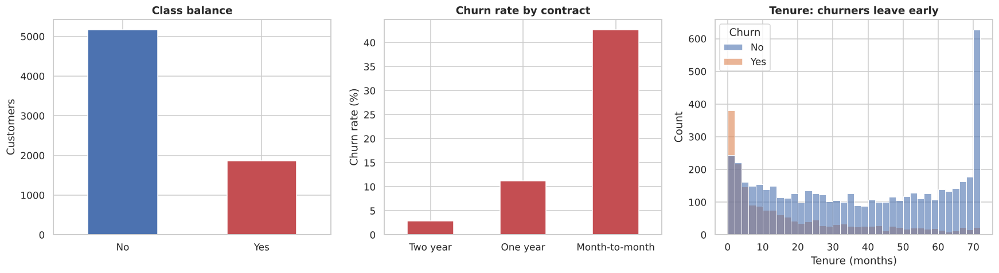
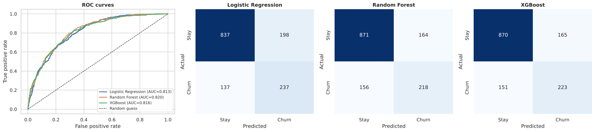
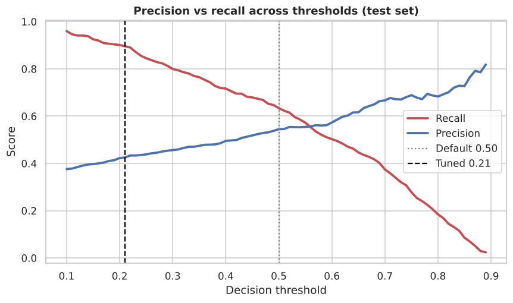
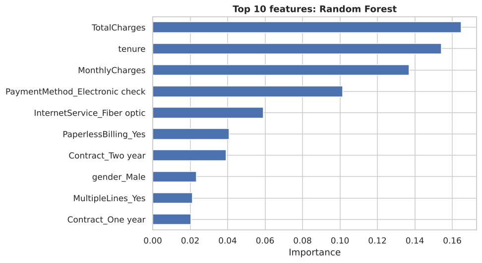

# 📉 Telco Customer Churn Prediction

> Predicting which telecom customers are about to leave, so the business can act **before** they churn.


## 🎯 Problem

Acquiring a new customer costs far more than keeping an existing one. About **26.5%** of customers in this dataset churn. The goal is a model that flags them early, with a focus on **recall** (a missed churner costs more than an unnecessary retention offer).

## 📊 Dataset

| | |
|---|---|
| Source | Telco Customer Churn (IBM sample dataset) |
| Rows / features | 7,043 customers · 20 features |
| Target | `Churn` (Yes / No) |
| Class balance | 73.5% stay · 26.5% churn |

Features cover demographics, account info (contract, billing, payment method), subscribed services, and charges.

## 🔬 What I did

1. **Cleaned** the data: `TotalCharges` had 11 blank values, all brand-new customers with `tenure = 0`, so they were filled with `0` (not the mean).
2. **Explored** churn patterns: contract type, tenure, class imbalance.
3. **Encoded** categoricals with one-hot encoding (`drop_first=True`) and mapped the target to 0/1.
4. **Split** 80/20 with **stratification** to preserve the churn ratio.
5. **Balanced** the training set with **SMOTE** (test set left untouched, so no leakage).
6. **Trained 3 models**: Logistic Regression (with `StandardScaler`), Random Forest, XGBoost.
7. **Compared** them with ROC-AUC, precision, recall, F1 and confusion matrices.
8. **Stress-tested** the setup: a no-SMOTE baseline, **5-fold cross-validation** (SMOTE inside the pipeline, no leakage), and **decision-threshold tuning**.
9. **Saved** the final Logistic Regression model + its scaler for reuse.

## 📈 Exploratory insights



- Churn is **imbalanced** (~1 in 4), which is why SMOTE is used.
- **Month-to-month** contracts churn at ~43%, vs ~11% (1-year) and ~3% (2-year).
- Churners leave **early**: the first few months of tenure are the danger zone.

## 🤖 Results

| Model | ROC-AUC | Recall (Churn) | Precision (Churn) | F1 (Churn) | Accuracy |
|---|---|---|---|---|---|
| **Logistic Regression** ⭐ | 0.813 | **0.634** | 0.545 | 0.586 | 0.762 |
| Random Forest | **0.820** | 0.583 | 0.571 | 0.577 | 0.773 |
| XGBoost | 0.816 | 0.596 | 0.575 | 0.585 | 0.776 |



**Why Logistic Regression?** All three models reach a similar AUC (~0.81–0.82), but Logistic Regression catches the most churners (**237 of 374**, recall 63%). For retention, that matters more than a few points of accuracy. It is also the simplest and most interpretable, and it came out on top in cross-validation too.

## 🧪 Going deeper: is the result trustworthy?

### 1. Does SMOTE actually help?

Same 3 models, trained with and without SMOTE, evaluated on the same untouched test set:

| Model | SMOTE | ROC-AUC | Recall | Precision |
|---|---|---|---|---|
| Logistic Regression | no | **0.842** | 0.567 | 0.658 |
| Logistic Regression | yes | 0.813 | **0.634** | 0.545 |
| Random Forest | no | 0.825 | 0.508 | 0.615 |
| Random Forest | yes | 0.820 | 0.586 | 0.560 |
| XGBoost | no | 0.818 | 0.521 | 0.589 |
| XGBoost | yes | 0.816 | 0.596 | 0.575 |

> **Honest finding:** SMOTE did **not** improve ranking quality (AUC is equal or *lower* with it). It mainly shifts the model toward flagging more churners at the 0.5 cutoff, which is a threshold effect. That is why I tune the threshold directly (below).

### 2. 5-fold cross-validation

SMOTE runs *inside* each training fold, so there is no leakage. Scores are mean ± std:

| Model | ROC-AUC | Recall | Precision |
|---|---|---|---|
| **Logistic Regression** | **0.834 ± 0.016** | **0.642 ± 0.049** | 0.593 ± 0.023 |
| Random Forest | 0.818 ± 0.014 | 0.567 ± 0.024 | 0.590 ± 0.024 |
| XGBoost | 0.814 ± 0.008 | 0.572 ± 0.024 | 0.579 ± 0.022 |

Results are stable across folds (std ≈ 0.01–0.02 AUC), and Logistic Regression is as good as or better than the tree models.

### 3. Threshold tuning

The cutoff was chosen on **out-of-fold training predictions** (maximising F2, which weighs recall 2× precision), then applied once to the test set:

| Threshold | Recall | Precision | Churners caught | False alarms |
|---|---|---|---|---|
| Default 0.50 | 0.634 | 0.545 | 237 / 374 | 198 |
| **Tuned 0.21** | **0.896** | 0.425 | **335 / 374** | 453 |



Lowering the cutoff catches **~90% of churners** instead of 63%, at the cost of more unnecessary retention offers. The right point depends on the cost of an offer vs. the value of a retained customer.

## 🔑 What drives churn



`TotalCharges`, `tenure` and `MonthlyCharges` lead, followed by **electronic-check payment**, **fiber-optic internet** and **contract type**.

**Business takeaway:** prioritize retention offers (discounts, contract upgrades) for **new, month-to-month, high-bill customers**.

## 📁 Project structure

```
churn-prediction/
├── Customer_Churn_Prediction.ipynb   # full, executed analysis
├── data/Dataset.csv                  # raw data
├── models/
│   ├── churn_model.pkl               # trained Logistic Regression
│   └── scaler.pkl                    # fitted StandardScaler
├── images/                           # charts used in this README
├── requirements.txt
└── README.md
```

## 🚀 Run it yourself

```bash
git clone <your-repo-url>
cd churn-prediction
pip install -r requirements.txt
jupyter notebook Customer_Churn_Prediction.ipynb
```

### Score a new customer

```python
import joblib

model  = joblib.load("models/churn_model.pkl")
scaler = joblib.load("models/scaler.pkl")

# `new_customer` = one-row DataFrame with the same 30 encoded columns as X in the notebook
prob = model.predict_proba(scaler.transform(new_customer))[0, 1]
print(f"Churn probability: {prob:.1%}")
```

## 🔭 Next steps

- Hyperparameter tuning (`GridSearchCV` / Optuna)
- Retrain the final model without SMOTE and with the tuned threshold
- SHAP values for per-customer explanations
- Deploy as a Streamlit / FastAPI app

## 🛠️ Tech stack

`Python` · `pandas` · `NumPy` · `scikit-learn` · `imbalanced-learn` · `XGBoost` · `matplotlib` · `seaborn`

---

⭐ If you found this useful, feel free to star the repo. Feedback is welcome!
